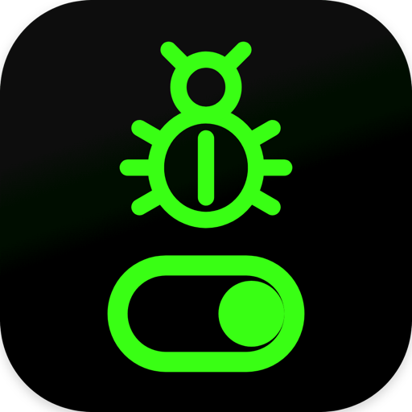

# 调试开关 · AdbSwitch

**一个用 root / Shizuku 真实开关 Android USB 调试的本地工具**

---

## ✨ 功能特性

| 功能 | 说明 |
| :--- | :--- |
| 🔌 **真实开关 USB 调试** | 用 root（`su`）或 Shizuku（shell uid 2000）改写系统设置，关掉后开发者选项里的 USB 调试项也显示关闭——是真实状态，不是伪装 |
| 📋 **QS 快捷磁贴** | 下拉通知栏加入「调试开关」磁贴，点一下即切换；关闭时自动拉起常驻通知，打开时自动撤掉 |
| 🔔 **临时关闭 + 常驻通知** | 关闭 USB 调试后在通知栏常驻一条「USB 调试：当前已关闭」通知，附带「恢复打开」一键动作，恢复正常即自动消失 |
| ⚡ **快捷打开（联动）** | 专为「打开银行 App 过检」设计：从启动器打开本 App 自动关调试并跳转目标 App；可在桌面生成目标 App 的原生快捷方式 |

## 📱 设备兼容性与运行要求

| 项目 | 要求 |
| :--- | :--- |
| 系统版本 | Android 8.0（API 26）及以上 |
| 授权方式 | root 授权，或已安装并授权的 [Shizuku](https://shizuku.rikka.app/)（无需 root） |

- 两种模式在 App 内「授权模式」中切换；未获得任一授权时开关不可用并给出明确提示。
- 已 root 设备首次打开授予超级用户权限即可；未 root 设备安装并授权 Shizuku 后以 shell 身份完成同样的改写。

## 🚀 安装与使用

1. 在 [**Releases**](https://github.com/gaoyilun/adbSwitch/releases) 页面下载最新 APK 并安装；
2. 首次打开按提示授予 **root** 或 **Shizuku** 授权；
3. 想要磁贴：下拉通知栏 → 编辑快捷开关 → 把「调试开关」拖进快捷区；
4. 想临时过检：开启「关闭时显示通知」，用完后点通知上的「恢复打开」即可；
5. 想从桌面直达联动 App：进入「快捷打开」→「创建桌面快捷方式」。

## 🔧 核心能力详解

1. **主界面开关**：打开 App 即可一键切换当前 USB 调试状态。
2. **通知控制中心快捷磁贴（QS Tile）**：下拉通知栏长按 / 编辑加入「调试开关」磁贴，点一下即切换。
3. **临时关闭 + 常驻通知**：开启「关闭时显示通知（临时关闭）」后关闭 USB 调试，并在通知栏常驻一条
   **「USB 调试：当前已关闭」** 通知，附带「恢复打开」一键动作；恢复正常即自动消失。
4. **快捷打开（联动）**：用于「打开银行 App 过检」场景——在设置里选择目标应用并开启后，
   **从启动器打开本 App** 会自动关调试并跳转到目标 App（每次进程启动只自动跳一次，之后可用「立即执行」）。
   还提供：开调试前先停止目标 App、立即执行联动、创建桌面原生快捷方式。

## 🛠️ 技术栈

- **语言**：Java
- **UI**：Android 原生 `PreferenceActivity` + Material 控件
- **授权通道**：root（`su`）/ [Shizuku](https://shizuku.rikka.app/)（shell uid 2000）
- **构建**：Gradle Kotlin DSL + AGP，编译 SDK 36，minSdk 27
- **依赖**：仅 Shizuku 工件与 AndroidX Material / SwipeRefreshLayout，其余用 framework 自带控件

## 🔄 检查更新

App 内置弱提示更新检查（GitHub 主通道 + 蒲公英备通道），逻辑完全离线可控：

- 版本判定**只比 `versionCode`**（单调递增整数），`versionName` 仅用于展示；
- 启动自动检查**节流 3 天**、且仅在主线程空闲时跑，磁贴 / 快捷方式开关不触发；
- 发现新版本**只做一次 Toast + 主页「关于」行显示「可更新」**，**绝不**强制弹窗；
- 下载与安装入口在「关于 → 检查更新」手动触发，支持 **SHA-256 完整性校验**；
- 远端版本元数据由本仓库 `update/update.json` 下发，与 App 内 `UpdateConfig` 对齐。

> 本仓库为公开分发仓：仅含项目主页与更新元数据（`update/`），**不含源码**。

## ❓ 常见问题

**Q：关掉 USB 调试后，开发者选项总开关还在吗？**

A：在。本工具只改 `adb_enabled`，开发者选项总开关仍可保留开启，不影响其它已设置项——但 USB 调试那一项会真实显示关闭。

**Q：没有 root 能用吗？**

A：可以。安装并授权 [Shizuku](https://shizuku.rikka.app/) 后，本 App 通过 Shizuku 以 shell 身份完成同样的改写，无需 root。

**Q：这是伪装关闭吗？**

A：不是。它通过系统设置真实改写 `adb_enabled`，系统 `UsbDeviceManager` 会据此重新配置 USB，
使 `sys.usb.config` 自动去掉 `adb`，是真实的状态变化。

---

  Made with ❤️ on Android

